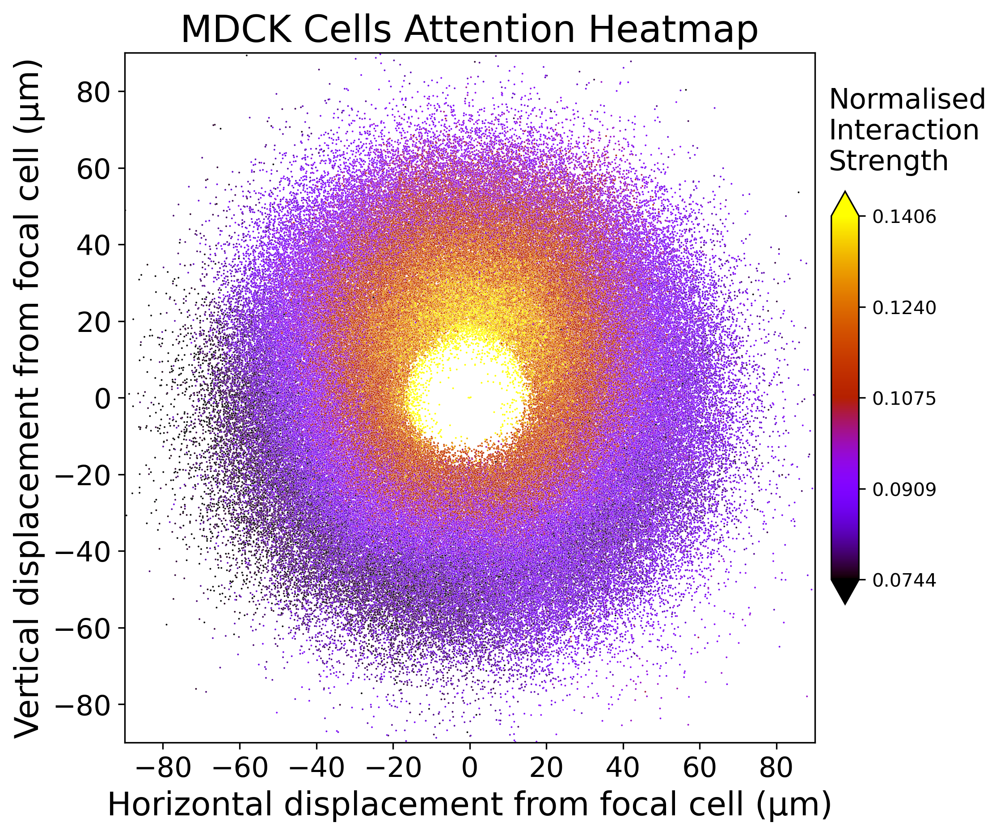
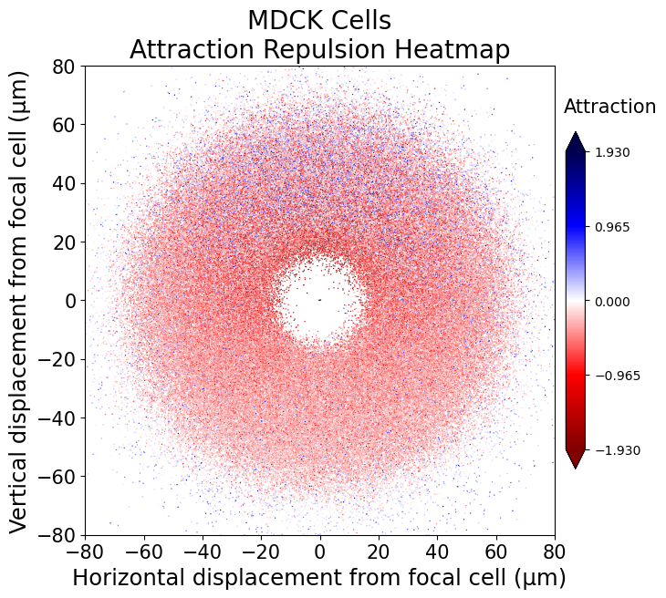
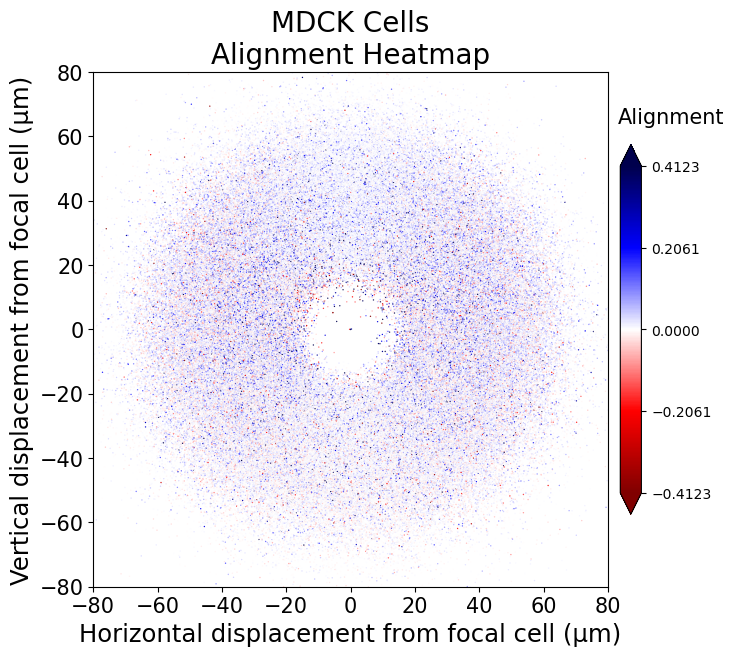

# ATTN

Deep attention networks are an exploratory tool for inferring how cell-cell interactions affect cell movement from cell trajectory data. ATTN provides functions to easily train a deep attention network on a cell trajectory data set, and apply various intepretability tools to the trained DAN to infer how cell-cell interactions affect cell movement therein.

Here we provide a brief tutorial on how to do this, using an example of publically available cell trajectory data from an assay of collectively migrating MDCK (kindey epithelium) cells. The model and inference tools are described in more detail in [ref], and the data can be acquired from [ref].

## Installation

**Option 1 - pip install**: The code used here is installable via `pip` using the command `pip install attn`.

**Option 2 - manual download**: If this is proving troublesome, please download all the `.py` files in this repository and add them to a folder entitled `deep_attention_networks` within your working directory in - i.e. your directory structure should look like:

- `deep_attention_networks`
  - `cell_trajectory_data_utils.py`
  - `model_definition_utils.py`
  - `model_evaluation_utils.py`
  - `train_model.py`
  - `training_utils.py`

### Dependencies

ATTN has been developed using the following packages and versions. ATTN only uses very standard aspects of these packages, so we expect that it should be compatible with similar versions. ATTN runs using Python3, with the following additional packages:

- `numpy 1.26.4`
- `matplotlib 3.9.2`
- `seaborn 0.13.2`
- `pytorch 2.5.0`
- `pandas 2.2.2`

## What data do I need?

Traning a deep attention network requires co-ordinate data for each cell at a common set of evenly spaced time points, in the format of a $2 \times N \times T$ numpy array $X$, where $N$ is the number of cells, $T$ is the number of timepoints, and $X[0,i,t]$, $X[1,i,t]$ are the $x$ and $y$ co-ordinates of cell $i$ at time $t$ respectively.

$$ X[0,:,:] = 
   \begin{pmatrix}
   x_1(t_1) & x_1(t_2) & \cdots & x_1(t_T) \\
   x_2(t_1) & x_2(t_2) & \cdots & x_2(t_T) \\
   \vdots   & \vdots   & \ddots & \vdots \\
   x_N(t_1) & x_N(t_2) & \cdots & x_N(t_T) \\
   \end{pmatrix} 
   \hspace{20mm}
   X[1,:,:] = 
   \begin{pmatrix}
   y_1(t_1) & y_1(t_2) & \cdots & y_1(t_T) \\
   y_2(t_1) & y_2(t_2) & \cdots & y_2(t_T) \\
   \vdots   & \vdots   & \ddots & \vdots \\
   y_N(t_1) & y_N(t_2) & \cdots & y_N(t_T) \\
   \end{pmatrix}
   $$

Where $(x_i(t), y_i(t))$ are the co-ordinates of cell $i$ at time $t$. 

$X$ can contain missing values. If analysing data from multiple experiments, you will need one trajectory data matrix for each experiment.

If the trajectory data contains multiple cell types, and you wish to learn type-dependent interaction dynamics, the type of each cell must be specifies in a $1 \times N$ numpy array $\mathcal{T}$.

$$ \mathcal{T} =
    \begin{pmatrix}
    \tau_1 & \tau_2 & \cdots & \tau_N 
    \end{pmatrix} 
    \hspace{20mm}
    \tau_i = \textrm{type of cell $i$} $$

Stndard procedure is to label $M$ cell types $0, \ldots, M-1$, but in principle any numerical labels can be used. In principle any number of cell types can be used, but as the number of cell types increases the model training time and memory requirement will increase, whilst the quality of inference will decrease. We have only used ATTN to analyse trajectory data containing two cell types.

Given trajectory data in this format, the procedure for training and using a deep attention network is as follows:
1) Use `create_dataset_from_trajectories()` to create the input and label data required to train a deep attention network.
2) Use `train_model()` to train a deep attention network.
3) Use various inference tools to infer from the trained deep attention network how cell-cell interactions affect cell movement.

In this tutorial we shall use cell trajectory data from an assay of collectively migrating kidney epithelial cells, namely Madin-Darby Canine Kidney (MDCK) cells. This assay is analysed using our deep attention network model in [ref], and was originally published and analysed using an earlier deep attention network model in [ref]. The data contains fifteen replicates of the same experiment, and in this tutorial, we shall suppose that all the trajectory matrices lie in one directory `mdck_data`, with `mdck_data/trajectories_i.npy` being the trajectory matrix $X$ for experiment $i$.

## 1) Input and label data creation

The first step is to create the input and label data required to train a deep attention network.

### Folder structure

For training, the input and label data must be in a single directory (let's call this `trajectory_data`), within which there must be two folders, `training_data` and `validation_data`. Within each of these there must be a folder for each experiment, containing the input and label data generated by the trajectory matrix from that experiment.

**Note**: There must be at least one experiment in each of the training and validation data directories, if possible we recommned a 70/30 split. If you only have data from one experiment, then we recommend splitting up that data into two.

The MDCK data contains 15 experiments, which we shall call `experiment_1`, `experiment_2` etc', so we put 11 of these in the training data directory, and 4 in the validation data directory. The file structure we are aiming for is:

- `trajectory_data`
  - `training_data`
    - `experiment_1`
      - `input_data.npy`
      - `labels.npy`
    - `experiment_2`
      - `input_data.npy`
      - `labels.npy`
    - ...
    - `experiment_11`
      - `input_data.npy`
      - `labels.npy`
  - `validation_data`
    - `experiment_12`
      - `input_data.npy`
      - `labels.npy`
    - ...
    - `experiment_15`
      - `input_data.npy`
      - `labels.npy`

where `input_data.npy` and `labels.npy` are the input and label data, which we shall now explain how to create. For now, ensure you have the correct folder structure with empty folders.

**Note**: The overall directory, and folders for each experiment, can be called whatever you want, but the folders containing the training and validation data *must* be called `training_data` and `validation_data`.

### Input and Label Creation

Input and label data can be created from a trajectory matrix using the `create_data_from_trajectories()` function (in `cell_trajectory_data_utils`). This function requires the following inputs:

- `X`: The trajectory matrix $X$
- `nn`: The number of nearest neighbours to use to predict cell movement
- `timestep`: Over what length of time to predict cell movement (measured in indices of $X$)
- `stdir`: A path specifying where to store the input and label data. 

This function will then create the input and label data, and deposit them in `stdir` under the names `input_data.npy` and `labels.npy`. It will also create a file called `input_data_parameters.csv` recording the different parameters used to generate the data from the trajectory matrix.

For the MDCK data, we use 10 nearest neighbours, with a prediction interval of 20 minutes. The time resolution of the data is 10 minutes, so this corresponds to `timestep=2`. We can process the data using the code


```python
for i in range(1,12):
    X = np.load('mdck_data/trajectories_i.npy')
    create_data_from_trajectories(X=X, nn=10, timestep=2, stdir='trajectory_data/training_data/experiment_i')            

for i in range(12,16):
    X = np.load('mdck_data/trajectories_i.npy')
    create_data_from_trajectories(X=X, nn=10, timestep=2, stdir='trajectory_data/validation_data/experiment_i')
```

This processes the data for experiments 1 - 11 and deposits the input and label data in the training data directory, and for experiments 12 - 15 deposits the input and label data in the validation data directory.

**Note**: If the trajectory matrix is very large but also contains lots of missing data (as may happen if cells often die or are lost track of by the tracking algorithm), we recommend passing `memory_saver=True`. This creates the input and label data in a way that uses as little memory as possible, but that may be slower for trajectory matrices with minimal missing data.

**Note**: To include cell type data, pass $\mathcal{T}$ to the argument `cell_types`.

**Note**: To use only trajectory data from a limited time range, you can pass the start and end indices of this range to `t_min` and `t_max` respectively.

## 2) Model Training

Given input and label data in the correct directory structure, we can train a deep attention network using the `train_deep_attention_network()` function, which requires only two arguments:

- `datadir`: A path to the top level directory containing the input and label data.
- `stdir`: A path to the directory to store the trained model in.

**Note**: Further arguments can be passed to control the details of the training process, see the documentation.

For us `datadir` is `trajectory_data`, and let's store our trained model in a directory called `mdck_dan` (if this directory doesn't already exist, `train_deep_attention_network()` will attempt to create it).

We thus run the code


```python
train_deep_attention_network(datadir='trajectory_data', stdir='mdck_dan')
```

**Note**: Under the hood, `train_deep_attention_network()` is training two feed forward neural networks. This can be a long process, and we strongly recommend running this function on a GPU if possible (ATTN will automatically search for a GPU, using the `torch.cuda.is_available()` function in `pytorch`, and will only run on CPU is this returns `False`, see [ref] for details).

This creates the following files in `stdir`:

- `model.pth`: The trained deep attention network,
- `model_training_parameters.csv`: A log of the parameters used to train the network.
- `training_log.txt`: A text file tracking the model training, useful for debugging.
- `losses.csv`: Contains the train and validation loss after each batch.
- `metrics_per_epoch.csv`: Contains the loss after every epoch.

## 3) Inference

Now for the exciting bit! We can use the trained deep attention network to infer how cell-cell interactions affect cell movement in the MDCK cell data.

First let's load in the trained deep attention network using `load_model()`:


```python
model = load_model(stdir='mdck_dan')
```

### Attention heatmaps

We can produce an Attention Heatmap, showing how cell-cell interaction strength is affected by the displacement of the interacting cells, using `plot_attention_heatmap()`:


```python
plt.figure()
plot_attention_heatmap(model=model, datadir='trajectory_data/training_data')
plt.show()
```



We see that MDCK cells take movement cues predominantly from their frontward neighbours.

**Note**: Here we provide `plot_attention_heatmap()` with the path to the directory containing the input and label data. `plot_attention_heatmap()` then builds a pytorch dataloader which the deep attention network can read data from. We could instead create the dataloader separately:


```python
dataloader = load_data(datadir='trajectory_data/training_data')
```

and pass this directly to `plot_attention_heatmap()`:


```python
plot_attention_heatmap(model=model, dataloader=dataloader)
```

This option, to pass a dataloader rather than have the function construct the dataloader, is available for all inference functions, and can save time if you are using multiple of them in a single session, as the dataloader only needs to be constructed once.

### Attraction-Repulsion and Alignment heatmaps

The syntax for producing attraction-repulsion and alignment heatmaps is very similar.


```python
plt.figure()
plot_attraction_repulsion_heatmap(model=model, datadir='trajectory_data/training_data')
plt.show()
```




```python
plt.figure()
plot_alignment_heatmap(model=model, datadir='trajectory_data/training_data')
plt.show()
```


